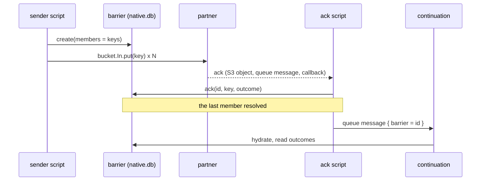

# Barriers

`native.barrier` waits for a known set of acknowledgements, then continues once. Use it when you
send work out (typically documents put into a bucket) and the other end answers later, one ack per
item, over whatever channel it likes.

A barrier is a **work list**: a set of member names, usually bucket keys, and one outcome per
member. Nothing waits and nothing polls. Each ack is an ordinary event that reaches a script; the
script records it, and the call that resolves the last member sends the continuation.



## Script API

```lua
-- send
local id = native.barrier.create({
  id = batch,                              -- optional; created again with the same id does nothing
  members = names,                         -- what the acks will name, e.g. "a.xml"
  continue_with = "finalize",              -- script that runs when every member is resolved
  state = { ref = ev.ref },                -- handed to the continuation
  deadline_s = 3600,                       -- optional; only feeds `status().overdue`
})
for _, name in names do native.bucket.In.put(batch .. "/" .. name, docs[name]) end

-- ack: runs for every acknowledgement, whatever channel it came by
local r = native.barrier.ack(batch, name, { ok = true, result = { id = "r-17" } })

-- finalize
function on_queue(ctx, ev)
  local b = native.barrier.hydrate(ev)     -- nil if not complete, or expired / cleaned up
  if not b then return end
  for member, outcome in b:results() do
    if not outcome.ok then native.log("warn", member .. ": " .. tostring(outcome.error)) end
  end
end
```

| Function | |
| --- | --- |
| `create(opts)` | registers the members and returns the id. `members` is required, at most 10 000, each at most 200 bytes, no duplicates. `id` is generated when absent. `continue_with` needs [`native.queue`](queue.md) (`"queue": true`). `state` is any JSON, at most 32 KB. Calling it again with the id of a barrier that is already complete does nothing; with the id of one cut short by a crash it finishes the job |
| `ack(id, member, outcome?)` | records the outcome, retires the member and, if none are left, sends the continuation. Returns `{ duplicate, complete, dispatched }` |
| `pending(id, limit?)` | the members still waiting, in name order (at most 100 per call) |
| `status(id)` | `{ id, total, ready, complete, dispatched, overdue, due_s }` |
| `hydrate(event)` | in the continuation: the barrier named by `event.barrier`, or `nil` |

`BarrierResult` from `hydrate`:

| | |
| --- | --- |
| `id`, `total`, `state` | the barrier id, the number of members, the value passed to `create` |
| `results()` | iterator of `member, outcome` over every member, in name order. Pages through the table 100 at a time, so it works for lists far larger than one value |
| `failures()` | array of `{ member, error, result }` for the members whose outcome is `ok = false` |

### Outcomes

An ack carries a small outcome: `{ ok = true | false, error = string?, result = any? }`, at most
8 KB (put anything larger in a bucket and send its key as the `result`). `ok` defaults to `true`.

A **failed ack still resolves its member**. Otherwise one rejected document would hold the whole
batch until its deadline. The barrier completes and the continuation decides what a failure means
(`b:failures()`).

The **first ack for a member wins**. A later one, a duplicate delivery or a partner's retry, is
reported as `duplicate = true` and changes nothing.

## Getting acks in

The barrier does not care how an ack arrives. Everything that can reach a script can ack: an S3
notification for an object the partner wrote, a message the partner put on the queue, a
[callback](callbacks.md). Route the event to one `ack` script and call `native.barrier.ack` there.

The ack has to say **which barrier and which member**. The simplest convention is to put both in the
keys you control:

```
In/<batch>/<doc>.xml     what you send; the member is "<doc>.xml"
Acks/<batch>/<doc>.json  what the partner writes back
```

```lua
-- router
local function on_route(_ctx, event)
  if event.bucket == "Acks" then return "ack" end
  return "default"
end

-- script "ack"
function on_queue(ctx, ev)
  local batch, doc = string.match(ev.key, "^([^/]+)/(.+)%.json$")
  if not batch then return end
  local body = native.json.decode(native.bucket.Acks.get(ev.key) or "{}")
  native.barrier.ack(batch, doc .. ".xml", { ok = body.status == "ok", error = body.error })
end
```

Two batches that both contain `invoice.xml` do not collide, because the barrier id is part of the
address. If the partner can echo back nothing but the document key, store a `member -> batch` row in
[`native.db`](dynamodb.md) when you send and look it up in the ack script.

## Guarantees

- **No lost ack.** `ack` is a sequence of idempotent steps (record the outcome if absent, delete the
  member's pending row, look for any pending row left) and there is no counter. A process that dies
  half way is repaired by the redelivered ack, which repeats the steps. There is no window in which
  the barrier can end up one short.
- **A continuation per completion, at least once.** The call that finds nothing pending claims the
  dispatch with a 60 second lease, sends the message, then marks it sent. Two calls racing for the
  last member send once. A call that dies after sending but before marking leaves a lease that
  lapses, and a later ack (a redelivery) sends again, so write the continuation to be safe to repeat.
- **A busy claim is an error.** While another call holds the lease, `ack` raises
  `barrier completion is being dispatched by another call; retry`. Let it fail: the queue redelivers
  and the next attempt sees the send finished.
- **Unknown members are refused.** Acking a name that is not on the list raises, so a stray event
  cannot complete a barrier.
- **Tenant-private.** The rows live in a partition that `native.db` cannot address, so scripts
  cannot read or forge them except through `native.barrier`.

## Cost and limits

Every backend call is one `max_data_ops` ([limits](limits.md)).

| Call | Data ops |
| --- | --- |
| `create` with N members | N + 3 |
| `ack` | 5; 8 for the call that sends the continuation; 4 for a duplicate |
| `results()` | 1 per 100 members |
| `pending`, `hydrate` | 2 |
| `status` | 3 |

`create` is one invocation, so the work list must fit in the tenant's `max_data_ops`
(default 1000, ceiling 10 000). Raise the tenant's limit for large batches.

Rows expire after a week like all [`native.db`](dynamodb.md) items. `ack` stops accepting an hour
before that, with `barrier expired`, so an expired pending row can never make a barrier look
finished. `hydrate` returns `nil` after expiry.

Barrier rows are not deleted when the continuation finishes; they expire. A barrier id can be reused
only after that.

## Deployment

Needs the `db` section of the [global config](deployment.md#configuration), and for `continue_with`
the tenant's `"queue": true` and a `queue.url`. No other IAM: the same table actions as
[`native.db`](dynamodb.md), including `Query`.

Without a queue, a barrier still works as a plain work list: `ack` tells you when `complete`, and
you act on it yourself. Nothing guarantees only one caller sees `complete = true` then, so claim the
work with `native.db.put_if_absent`.

## Not covered

- **A member that never acks.** Nothing runs. `deadline_s` makes `status(id).overdue` true, but
  something has to look: schedule a script that reads `status`, or send a delayed
  [queue](queue.md) message from `create`'s caller (`delay_s` up to 15 minutes, re-sending itself).
  A timer trigger is on the [roadmap](roadmap.md).
- **Growing a barrier.** The members are fixed at `create`.
- **Recovering a lost notification.** If a partner's ack object exists but its event was lost,
  nothing acks the member. List the bucket and ack the missing keys by hand.
