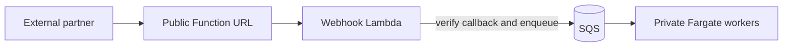

# Choosing Lambda, Fargate and ALB

Fargate is the main execution environment for integraal: it consumes queues, processes files,
and runs integration scripts with warm caches and outbound HTTP throttling. Lambda provides
the public webhook entrypoint and an optional runtime for short synchronous calls.

## Public partner callbacks: webhook Lambda

The main Lambda use case is receiving callbacks from external partners while keeping the
Fargate workers in a private network.

The dedicated `integraal-webhook` Lambda verifies a single-use callback token, consumes the
saved callback, and enqueues the request. It returns once the request is queued; a Fargate
worker runs the continuation script. Partner requests therefore do not need access to the
cluster or an ALB. See [Callbacks and the webhook Lambda](callbacks.md) for the URL format,
saved state and deployment configuration.

This endpoint implements integraal's signed callback protocol. Other partner webhook formats
need an adapter that authenticates the request and submits the appropriate queue message.

## Quick lookups: runtime Lambda

The separate `integraal-lambda` entrypoint runs Luau scripts and returns their results through
[direct Lambda invocation](triggers.md#direct-lambda-invoke). It is useful for occasional,
bounded queries from external systems, for example:

- resolve a partner's customer or product ID using a tenant's reference data;
- read a job's saved status or result;
- validate or normalize a small submission before returning an answer.

The runtime Lambda has full access to the configured data sources through the same engine
and native API as Fargate. Access still follows tenant grants, HTTP allowlists, invocation
limits, the function's IAM role and network connectivity. It is a full script runtime, rather
than a lookup-only runtime; the dedicated webhook Lambda, by contrast, runs no scripts.

Deployment differences still apply: local directory stores need a mounted volume such as
EFS, outbound HTTP throttling is Fargate-only, and the background HTTP batch submission mode
requires Fargate. See [File system](filesystem.md), [Outbound HTTP](http.md#throttling) and
[Batch jobs](batch.md).

An external caller needs AWS credentials and permission to invoke the runtime Lambda, or an
authenticated HTTP adapter that invokes it. The runtime entrypoint expects the invocation
envelope; it does not itself implement a public HTTP lookup endpoint. The webhook Function
URL is specifically for callbacks.

## Same-VPC peer calls: internal ALB

An ALB is recommended only when the Fargate cluster and its peer system are in the same VPC
and need synchronous HTTP calls. Use an internal ALB with the server's
[`POST /v1/{tenant}/{script}`](triggers.md#alb-fargate-http) endpoint.

For external partner calls, use the public webhook Lambda for callbacks, or the runtime
Lambda invocation path for synchronous lookups. A public ALB is not the recommended partner
entrypoint in this architecture. Queue-only Fargate workers do not need an ALB.

## Other Lambda roles

The [intake Lambda](ingress.md) classifies queue messages into worker size classes. The runtime
Lambda can also receive scheduled `system.tick` events to sweep timers and dispatch work;
the resulting queues still need consumers. See [Schedules and timers](schedules.md).

These are small intake and dispatch jobs around the Fargate workers. Steady queue processing,
large transformations and work requiring outbound throttling belong on Fargate.
