# Integration patterns

A quick map of every way work gets into integraal, and every way a script talks to the outside
world. Each pattern links to its full page.

## Getting work in

### Synchronous call (Lambda invoke)
Caller waits for the script's return value. [Triggers](triggers.md#direct-lambda-invoke)

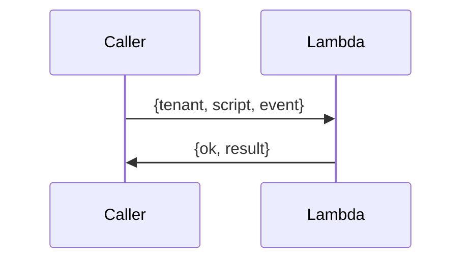

### Synchronous HTTP (ALB → Fargate)
`POST /v1/{tenant}/{script}`; body is the event, response is the return value. [Triggers](triggers.md#alb-fargate-http)

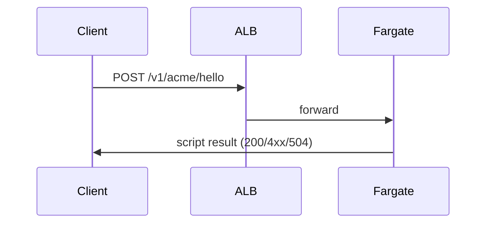

### Queue worker (SQS → Fargate)
Asynchronous; deleted only on success, retried, then dead-lettered. [Triggers](triggers.md#sqs-fargate)

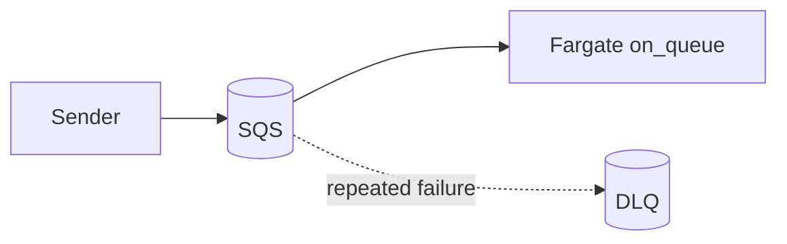

### File drop (S3 notification)
An object arrives; the notification is split into one invocation per object; the router picks the
script. The handler may ask for the object to be deleted afterwards. [Triggers](triggers.md#s3-notifications)

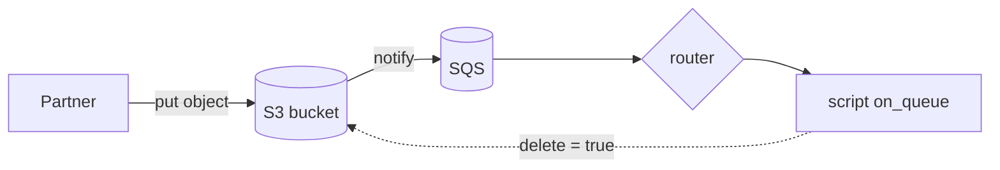

### Routing a shared queue
Messages carry no script name; the tenant's router script chooses. [Router](router.md)

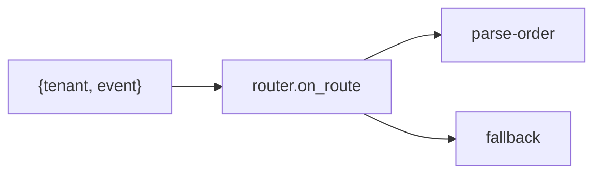

### Size-based placement (intake)
An intake Lambda forwards each message to a per-class job queue, so heavy tenants don't starve
light ones. [Worker classes](ingress.md)

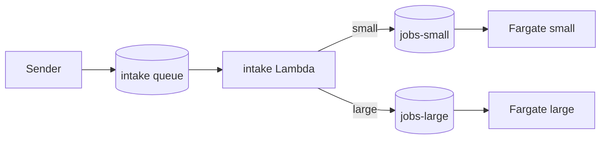

## Waiting for something external

### Callback (webhook)
Hand a single-use signed URL to a third party; when they call it, a script runs with the state you
saved. [Callbacks](callbacks.md)

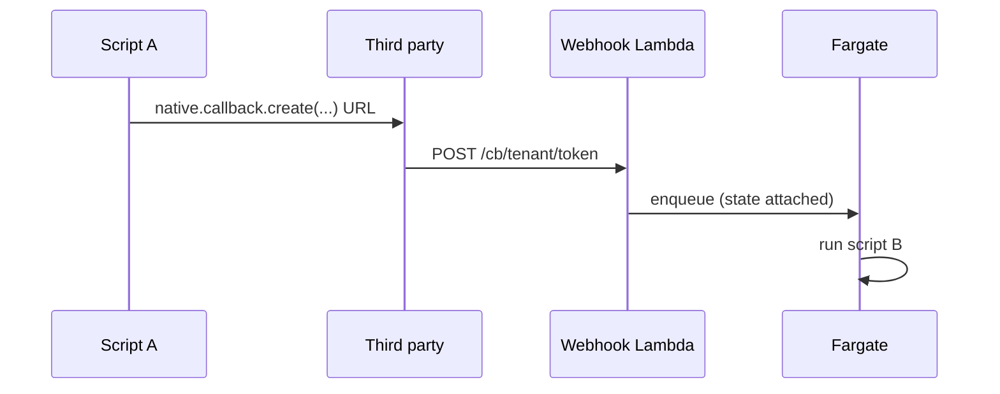

### Batch job (dedicated partner bucket)
Submit a job, end the invocation, continue when the partner writes `done.json`. Nothing waits.
[Batch jobs](batch.md)

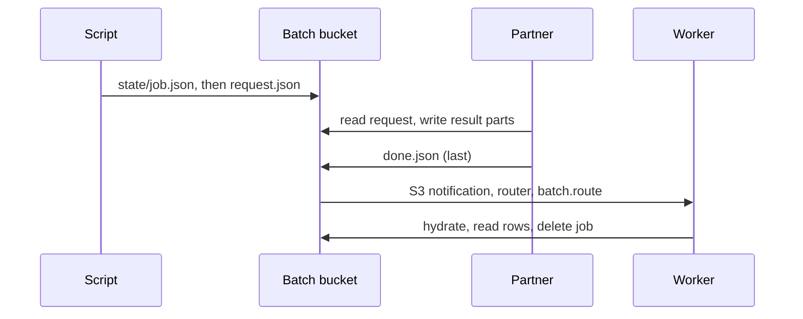

## Talking to the outside

### Outbound HTTP
Only URLs in the tenant's `http.allow`; no redirects, no private IPs. Streamable. [Outbound HTTP](http.md)

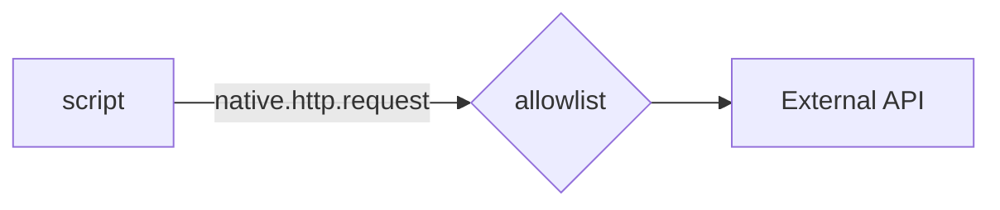

### Streaming transform (S3 → XML/zip/gzip → S3)
Large files are processed as streams, so memory is bounded by one event. [Streams and XML](streams-xml.md)

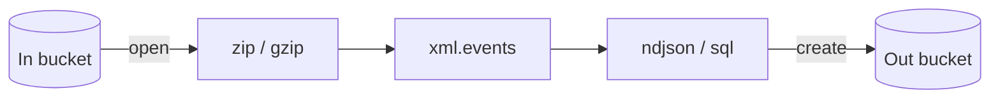

### Scratch SQL
Load rows into a per-run SQLite database, query it, optionally persist it to a bucket. [SQL](sql.md)

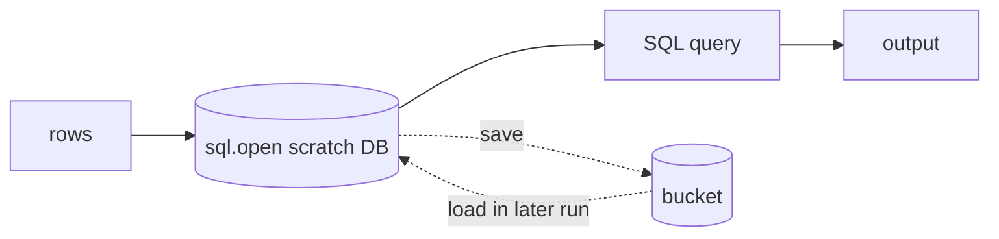

## Coordination and state

### Locks
Mutual exclusion in-process or across processes, with an enforced lease. [Locks](locks.md)

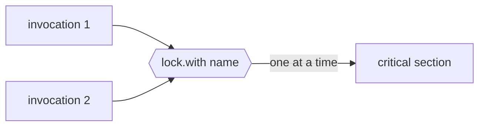

### Small state (DynamoDB)
Small items per tenant with a 24h TTL; also backs callbacks and cross-process locks. [DynamoDB](dynamodb.md)

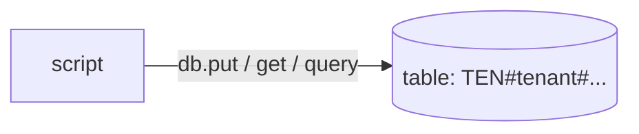

### Deadlines
Nested time-boxed blocks that interrupt the script. [Native API](native-api.md)

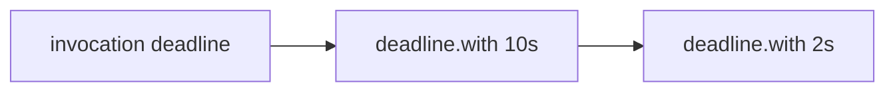

## Which one?

| Need | Pattern |
| --- | --- |
| Answer right now | Lambda invoke or ALB HTTP |
| Fire and forget, with retries | SQS queue worker |
| React to a file arriving | S3 notification |
| One queue, many scripts | Router |
| Isolate heavy tenants | Worker classes (intake) |
| Third party calls us back | Callback |
| Partner does heavy work for us | Batch job |
| Call an external API | Outbound HTTP |
| Crunch large files | Streams, zip, gzip, SQL |
| Avoid concurrent runs | Locks |
