# Integration patterns

A quick map of every way work gets into integraal, and every way a script talks to the outside
world. Each pattern links to its full page.

The [mega integration test](local-development.md#mega-integration-test) exercises all of them
together. Its outside world is **megalith**, a stand-in for the hypothetical system integraal acts
as the integration layer for.

## Getting work in

### Synchronous call (Lambda invoke)
Caller waits for the script's return value. [Triggers](triggers.md#direct-lambda-invoke)

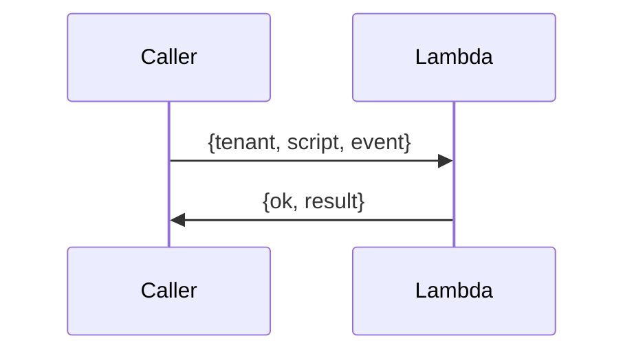

### Synchronous HTTP (ALB → Fargate)
`POST /v1/{tenant}/{script}`; body is the event, response is the return value. [Triggers](triggers.md#alb-fargate-http)

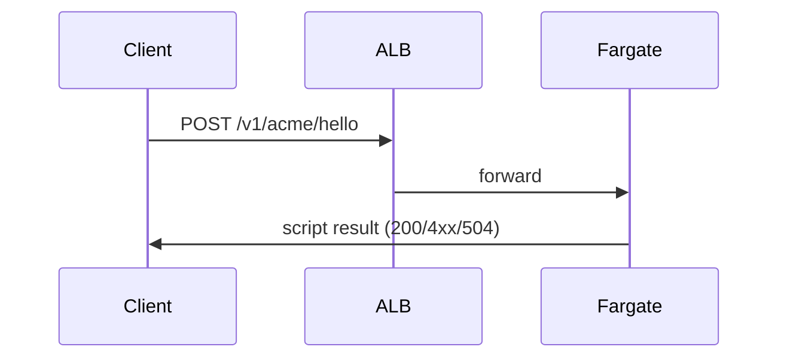

### Queue worker (SQS → Fargate)
Asynchronous; deleted only on success, retried, then dead-lettered. [Triggers](triggers.md#sqs-fargate)

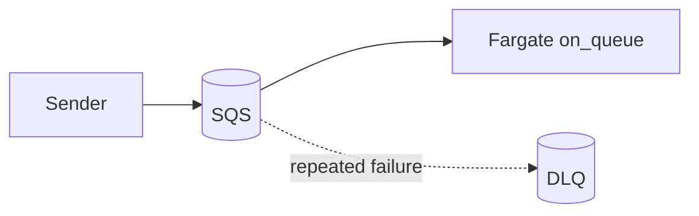

### File drop (S3 notification)
An object arrives; the notification is split into one invocation per object; the router picks the
script. The handler may ask for the object to be deleted afterwards. [Triggers](triggers.md#s3-notifications)

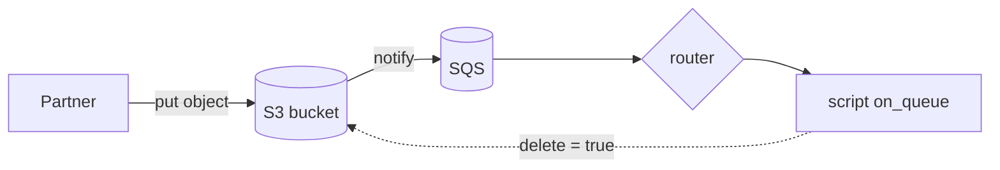

### Routing a shared queue
Messages carry no script name; the tenant's router script chooses. [Router](router.md)

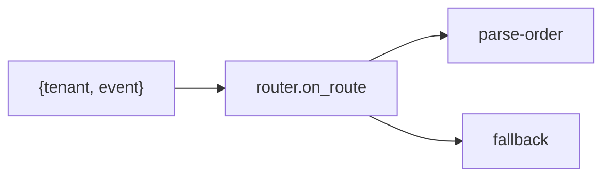

### Size-based placement (intake)
An intake Lambda forwards each message to a per-class job queue, so heavy tenants don't starve
light ones. [Worker classes](ingress.md)

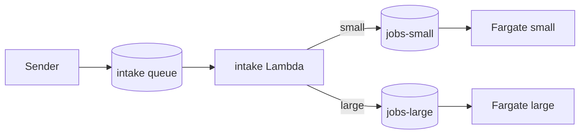

## Waiting for something external

### Callback (webhook)
Hand a single-use signed URL to a third party; when they call it, a script runs with the state you
saved. [Callbacks](callbacks.md)

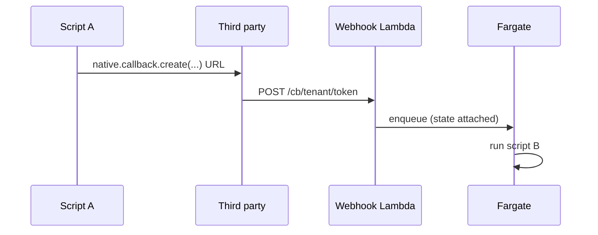

### Batch job (dedicated partner bucket)
Submit a job, end the invocation, continue when the partner writes `done.json`. Nothing waits.
[Batch jobs](batch.md)

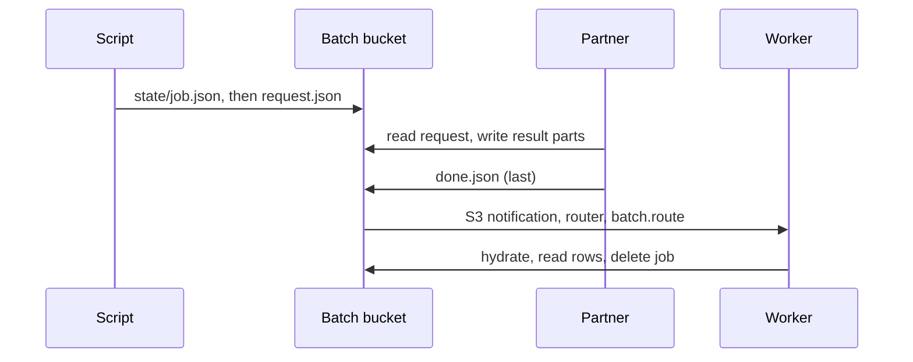

## Talking to the outside

### Outbound HTTP (allowlist and throttle)
Only URLs in the tenant's `http.allow`; no redirects, no private IPs. The operator can also cap
concurrency and request rate per target URL, for all tenants together. A throttled call waits for a
slot, or fails with `throttled:` if the invocation deadline comes first. Limits are per Fargate
process and not applied on Lambda. [Outbound HTTP](http.md), [Throttling](http.md#throttling)

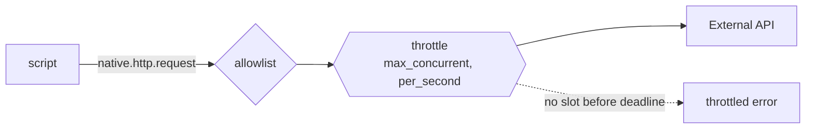

### Streaming transform (S3 → XML/zip/gzip → S3)
Large files are processed as streams, so memory is bounded by one event. [Streams and XML](streams-xml.md)

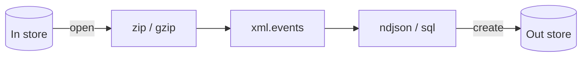

### Scratch SQL
Load rows into a per-run SQLite database, query it, optionally persist it to a store. [SQL](sql.md)

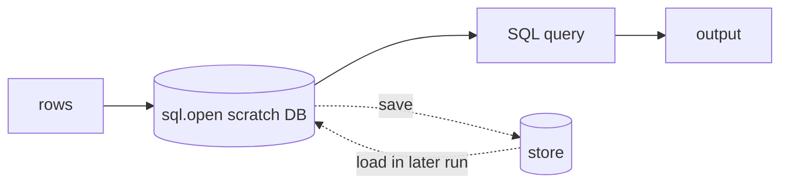

## Coordination and state

### Locks
Mutual exclusion in-process or across processes, with an enforced lease. [Locks](locks.md)

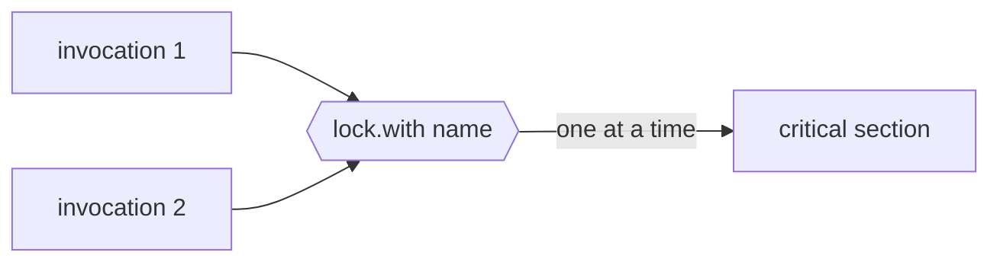

### Small state (DynamoDB)
Small items per tenant with a one-week TTL, atomic counters and claim-once keys; also backs callbacks and cross-process locks. [DynamoDB](dynamodb.md)

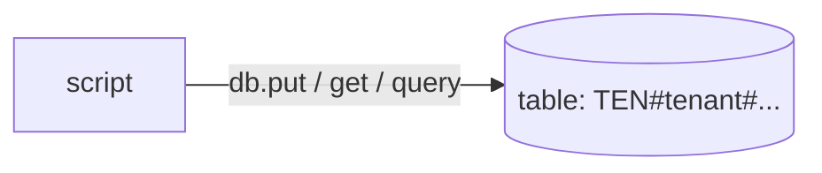

### Deadlines
Nested time-boxed blocks that interrupt the script. [Native API](native-api.md)

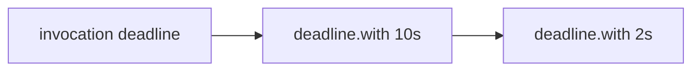

## Scatter and gather

Split work into parts that run in parallel, then do one final step when every part is done.
There are two ways, depending on who does the parallel work.

### Acknowledgements arrive from outside
You put documents in a store, the other end acks them over any channel (S3 marker objects, queue
messages, a callback), and something must happen when the last ack is in. That is a
[barrier](barrier.md): the work list is the set of object keys you sent, each ack records an outcome,
and the ack that resolves the last member sends the continuation.

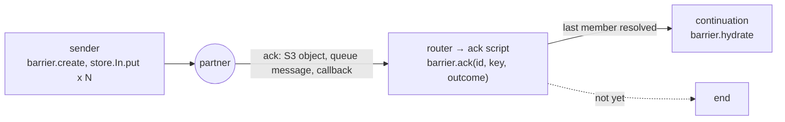

```lua
-- send
local id = native.barrier.create({ id = batch, members = names, continue_with = "finalize",
                                   state = { ref = ev.ref }, deadline_s = 3600 })
for _, name in names do native.store.In.put(batch .. "/" .. name, docs[name]) end

-- ack (routed from an S3 event on "Acks/<batch>/<name>.json")
native.barrier.ack(batch, name, { ok = true })

-- finalize
local b = native.barrier.hydrate(ev)
if not b then return end
for member, outcome in b:results() do ... end
```

### Partner does the parallel work
One [batch job](batch.md) with several independent queries: the partner runs them however it likes,
and `done.json` is the barrier. The continuation sees every result at once.

### Workers do the parallel work
The script scatters with [`native.queue.send`](queue.md), each shard counts itself with
[`native.db`](dynamodb.md) when it finishes, and the shard that completes the set sends the gather
message. `put_if_absent` makes a repeated delivery count once, and claiming the gather the same way
makes it run exactly once.

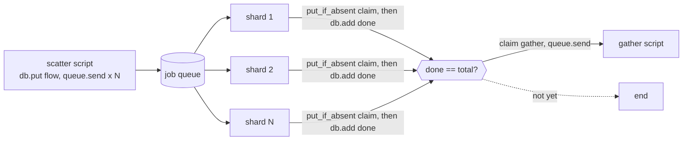

```lua
-- scatter
local flow = native.crypto.hex_encode(native.crypto.random(8))
native.db.put("flow", flow, { total = #chunks, gather = "merge" })
local msgs = {}
for i, chunk in ipairs(chunks) do
  msgs[i] = { script = "work", event = { flow = flow, shard = i, chunk = chunk } }
end
native.queue.send(msgs)

-- shard (on_queue)
local result = do_work(ev.chunk)
native.store.Out.put(ev.flow .. "/" .. ev.shard .. ".json", native.json.encode(result))
if native.db.put_if_absent("flow-seen", ev.flow .. "/" .. ev.shard, true) then   -- once per shard
  local flow = native.db.get("flow", ev.flow)
  if native.db.add("flow-done", ev.flow) == flow.total
     and native.db.put_if_absent("flow-gathered", ev.flow, true) then             -- once per flow
    native.queue.send({ script = flow.gather, event = { flow = ev.flow } })
  end
end
```

For a known list of members (documents you sent, files you expect back) use a
[barrier](barrier.md) instead of this recipe: it records an outcome per member, can say which are
still missing, and has no counter that a crash can leave short.

Two things the recipe does not do for you:

- **A shard that fails for good.** On its last attempt (`ctx.attempt` equal to the queue's
  `maxReceiveCount`) the shard can write a failure marker and count itself anyway, so the gather runs
  with a partial result instead of waiting forever.
- **A lost count.** A process that dies between `put_if_absent` and `add` leaves the counter one short.
  Send a delayed check (`native.queue.send({ script = "check", event = { flow = flow }, delay_s = 600 })`)
  that compares `native.db.get("flow-done", flow)` with `total`, and either re-sends itself, or gathers
  what exists once the flow is overdue. Flow rows expire after a week.

Many parts at once can flood the queue for everyone else; per-tenant concurrency caps are on the
[roadmap](roadmap.md).

## Which one?

| Need | Pattern |
| --- | --- |
| Answer right now | Lambda invoke or ALB HTTP |
| Fire and forget, with retries | SQS queue worker |
| React to a file arriving | S3 notification |
| One queue, many scripts | Router |
| Isolate heavy tenants | Worker classes (intake) |
| Third party calls us back | Callback |
| Partner does heavy work for us | Batch job |
| Call an external API | Outbound HTTP |
| Protect a partner API from overload | HTTP throttle (`max_concurrent`, `per_second`) |
| Crunch large files | Streams, zip, gzip, SQL |
| Avoid concurrent runs | Locks |
| Split work and join the results | Scatter and gather (`queue.send` plus `db.add`), or one batch job with several queries |
| Do something when every document has been acked | Barrier |
| Run something once despite redelivery | `db.put_if_absent` |
