# Integration patterns

A quick map of every way work gets into integraal, and every way a script talks to the outside
world. Each pattern links to its full page.

The [mega integration test](local-development.md#mega-integration-test) exercises all of them
together. Its outside world is **megalith**, a stand-in for the hypothetical system integraal acts
as the integration layer for.

## Getting work in

### Synchronous call (Lambda invoke)
Caller waits for the script's return value. [Triggers](triggers.md#direct-lambda-invoke)

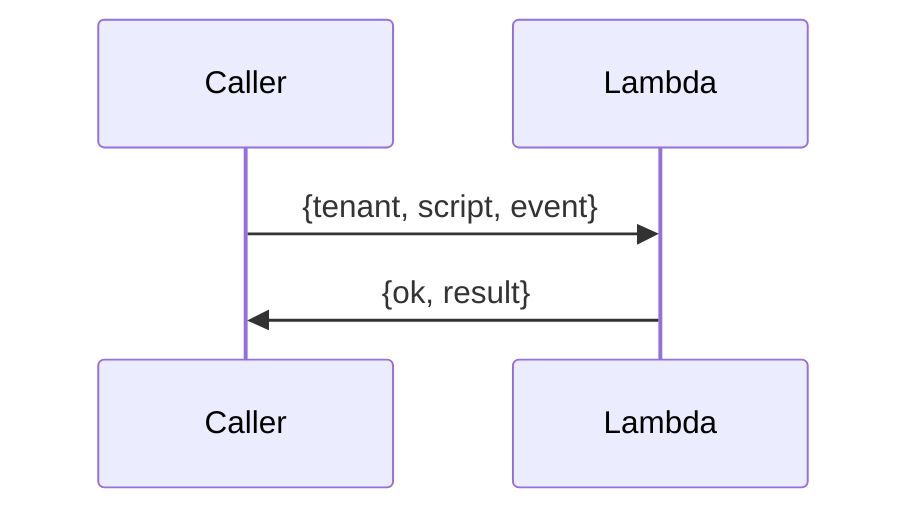

### Synchronous HTTP (ALB → Fargate)
`POST /v1/{tenant}/{script}`; body is the event, response is the return value. [Triggers](triggers.md#alb-fargate-http)

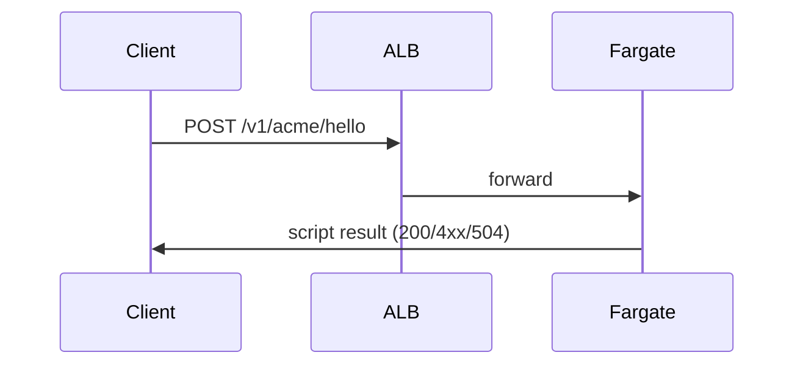

### Queue worker (SQS → Fargate)
Asynchronous; deleted only on success, retried, then dead-lettered. [Triggers](triggers.md#sqs-fargate)

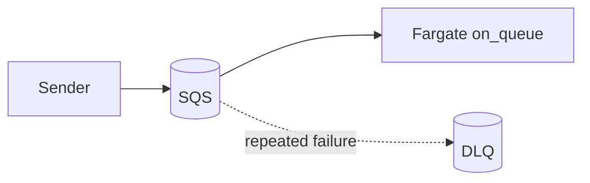

### File drop (S3 notification)
An object arrives; the notification is split into one invocation per object; the router picks the
script. The handler may ask for the object to be deleted afterwards. [Triggers](triggers.md#s3-notifications)

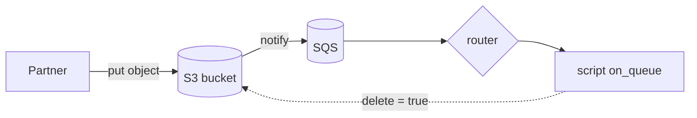

### Routing a shared queue
Messages carry no script name; the tenant's router script chooses. [Router](router.md)

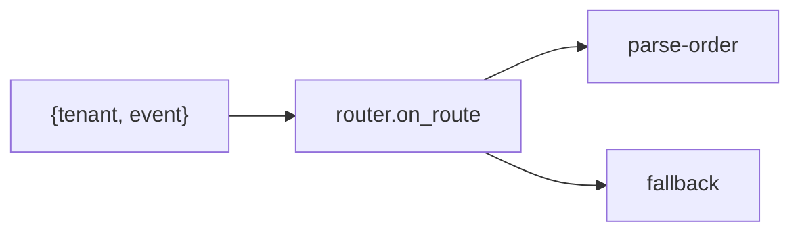

### Size-based placement (intake)
An intake Lambda forwards each message to a per-class job queue, so heavy tenants don't starve
light ones. [Worker classes](ingress.md)

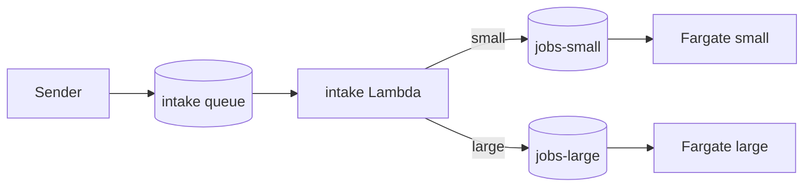

## Waiting for something external

### Callback (webhook)
Hand a single-use signed URL to a third party; when they call it, a script runs with the state you
saved. [Callbacks](callbacks.md)

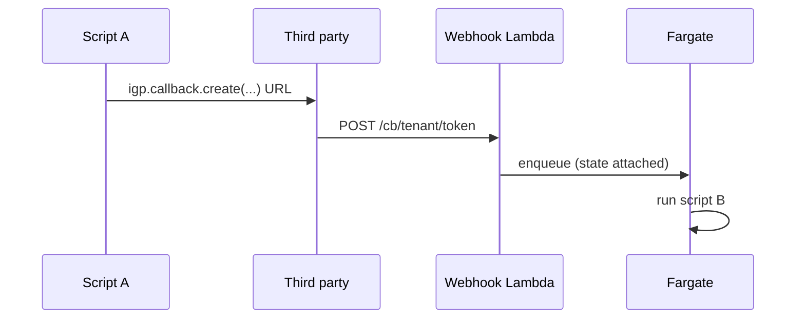

### Batch job (dedicated partner bucket)
Submit a job, end the invocation, continue when the partner writes `done.json`. Nothing waits.
[Batch jobs](batch.md)

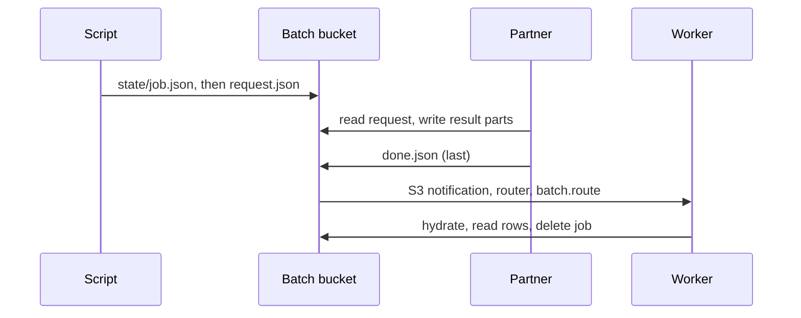

## Talking to the outside

### Outbound HTTP (allowlist and throttle)
Only URLs in the tenant's `http.allow`; no redirects, no private IPs. The operator can also cap
concurrency and request rate per target URL, for all tenants together. A throttled call waits for a
slot, or fails with `throttled:` if the invocation deadline comes first. Limits are per Fargate
process and not applied on Lambda. [Outbound HTTP](http.md), [Throttling](http.md#throttling)

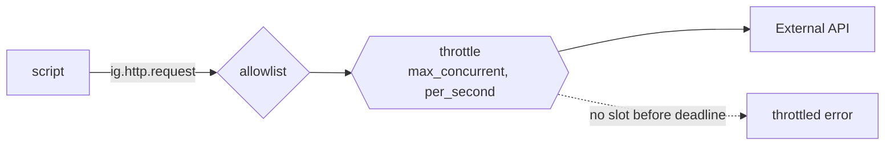

### Streaming transform (S3 → XML/zip/gzip → S3)
Large files are processed as streams, so memory is bounded by one event. [Streams and XML](streams-xml.md)

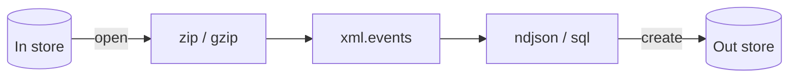

### Scratch SQL
Load rows into a per-run SQLite database, query it, optionally persist it to a store. [SQL](sql.md)

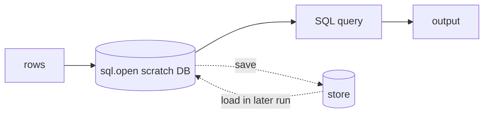

## Coordination and state

### Locks
Mutual exclusion in-process or across processes, with an enforced lease. [Locks](locks.md)

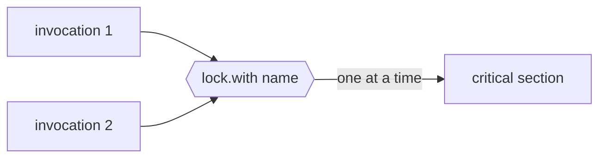

### Recoverable consumers
Use [`igp.claim`](claims.md) for work that may be redelivered: acquire a lease, renew it while
working, then store the completed result. A crashed worker's lease expires so a retry can take
over. A completed request returns its saved result. External effects must still be safe to repeat.

### Small state (DynamoDB)
Small items per tenant with a one-week TTL, atomic counters and claim-once keys; also backs callbacks and cross-process locks. [DynamoDB](dynamodb.md)

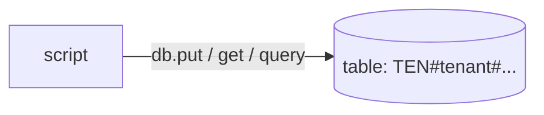

### Deadlines
Nested time-boxed blocks that interrupt the script. [Native API](native-api.md)

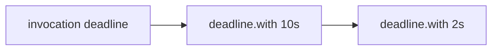

## Scatter and gather

Split work into parts that run in parallel, then do one final step when every part has an
outcome. Scatter dispatches the work; a [barrier](barrier.md) coordinates the gather for a known
set of members. The same barrier works for queue workers and external acknowledgements.

### Workers do the parallel work

Create the barrier before recording work with [`ig.queue.handoff`](queue.md#durable-handoff).
The minute sweep delivers each persisted message, recovering interrupted sends. Each worker
saves its result and acknowledges its member. The last acknowledgement sends the continuation,
which reads the outcomes with `hydrate`.

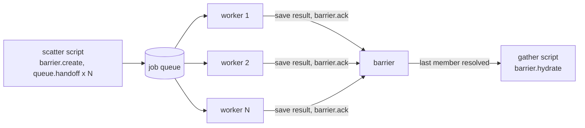

```lua
local igp = require("@native/patterns@1")
-- scatter: ev.flow and ev.chunks must be stable across retries of this request
local names = {}
for i, _ in ipairs(ev.chunks) do names[i] = tostring(i) end
if #names == 0 then return end
local id = igp.barrier.create({
  id = ev.flow, members = names, continue_with = "merge", deadline_s = 3600,
})
local msgs = {}
for i, chunk in ipairs(ev.chunks) do
  msgs[i] = { script = "work", event = { flow = id, member = names[i], chunk = chunk } }
end
for _, message in ipairs(msgs) do
  ig.queue.handoff(id .. "/" .. message.event.member, message)
end

-- work (on_queue): do_work and the result write must be safe to repeat
local result = do_work(ev.chunk)
local key = ev.flow .. "/" .. ev.member .. ".json"
ig.store.Out.put(key, ig.json.encode(result))
igp.barrier.ack(ev.flow, ev.member, { ok = true, result = { key = key } })

-- merge (on_queue): publishing the merged output must also be safe to repeat
local b = igp.barrier.hydrate(ev)
if not b then return end
for member, outcome in b:results() do
  -- Read successful results from outcome.result.key; handle failures explicitly.
end
```

The barrier replaces the manual `put_if_absent` → `db.add` → claim → send recipe. That recipe
can lose a count if a worker dies after claiming its member, and lose the gather message if it dies
after claiming dispatch. Repeating `barrier.ack` repairs an interrupted acknowledgement and retries
continuation dispatch. It does not make the entire workflow atomic:

- **Scatter can stop halfway.** Retry the originating request with the same flow id, member list
  and inputs, and resend the work. Barrier creation is retryable and duplicate acks are harmless;
  workers must tolerate duplicate messages. A fresh random flow id on each attempt would create
  separate, unfinished flows. Arrange a durable retry source, such as an incoming queue message.
- **A worker can stop between its side effect and its ack.** Save the result before acking and let
  failures propagate so the queue retries. Use stable result keys and, for external side effects,
  the destination's idempotency mechanism. A `put_if_absent` claim before work can strand that work
  after a crash; it is not a substitute for retryable effects.
- **A member can exhaust its retries.** Set a deadline and handle the overdue event by inspecting
  pending members, retrying missing work or explicitly acking a permanent failure. A deadline
  reports overdue work; it does not resolve members or gather partial results automatically.
- **The gather can run more than once.** Continuation delivery is at least once. Make its effects
  safe to repeat too; see [barrier crash recovery](barrier.md#crash-recovery).

### Acknowledgements arrive from outside

Create the barrier with the object keys you plan to send, then put the documents in a store.
Route the partner's S3 marker objects, queue messages or callbacks to a script that calls
`igp.barrier.ack(id, member, outcome)`. The continuation gathers the outcomes just as it does
for queue workers. Keep the batch id and object keys stable when retrying dispatch, and make
partner submissions safe to repeat. See [getting acks in](barrier.md#getting-acks-in).

### Partner does the parallel work

One [batch job](batch.md) can contain several independent queries: the partner runs them however
it likes, and `done.json` signals completion. The continuation sees every result at once; no
separate `igp.barrier` is needed.

Many parts at once can flood the queue for everyone else; per-tenant concurrency caps are on the
[roadmap](roadmap.md).

## Which one?

| Need | Pattern |
| --- | --- |
| Answer right now | Lambda invoke or ALB HTTP |
| Fire and forget, with retries | SQS queue worker |
| React to a file arriving | S3 notification |
| One queue, many scripts | Router |
| Isolate heavy tenants | Worker classes (intake) |
| Third party calls us back | Callback |
| Partner does heavy work for us | Batch job |
| Call an external API | Outbound HTTP |
| Protect a partner API from overload | HTTP throttle (`max_concurrent`, `per_second`) |
| Crunch large files | Streams, zip, gzip, SQL |
| Avoid concurrent runs | Locks |
| Split work and join the results | Scatter and gather (`queue.handoff` plus `barrier`), or one batch job with several queries |
| Do something when every document has been acked | Barrier |
| Recover work across crashes and redelivery | Consumer claim (lease plus durable result) |
